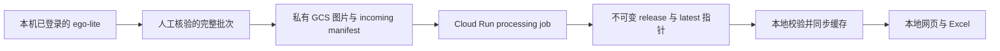

# XHS Observer

可复用的小红书内容观察工具。用本地网页浏览图文，使用私有 Google Cloud Storage 保存数据和图片。包含“信用卡与福利”“北美生活热门”两个栏目，每个完整批次各选 5 篇。

## 使用方式

建议使用 Python 3.11 或更新版本。

```bash
git clone https://github.com/tanmiemie/xhs-observer.git
cd xhs-observer
python3 -m venv .venv
source .venv/bin/activate
pip install -r requirements.txt
python app.py --open
```

打开 `http://127.0.0.1:8127`。macOS 也可双击 `start.command`。

网页提供栏目选择、按周回看、全文检索、点赞/收藏/评论排序、图片放大、原帖链接、选题笔记及 Excel 导出。标记和笔记保存在当前浏览器，可以备份和恢复。查看已同步的缓存不需要联网。

## 数据怎样流动



采集使用用户已登录的浏览器。云端仅保存和整理采集结果，不保存小红书 Cookie、浏览器配置或登录凭据。公开仓库只包含工具与经整理的摘要 demo；完整正文和原图保存在用户自己的私人数据源。

## 采集与导入

先阅读当前安装版本的浏览器说明：

```bash
ego-browser skill
```

`collectors/detail.mjs` 提供详情采集函数，供 ego-browser 的 Node runtime 调用。输入必须是浏览器里实际观察到的帖子链接，并传入已授权的 `page`。函数读取详情页标题、正文、公开发布时间、互动量和配图；遇到登录、验证码或用户接管时应停止。

采集和人工核验后，按 `docs/batch-format.md` 整理成完整批次：

```bash
python -c 'from core import ingest_local; ingest_local("/absolute/path/to/batch.json")'
```

按作者 ID 和作者名称排除品牌自发内容。默认排除 `北美撸卡MaxWorth`，可以在配置中改成其他作者。该规则在导入和云端处理时执行，不只是在网页上隐藏。

一个批次不足 5 篇、含重复帖子、缺互动数、存在排除作者或周分组日期不符时，拒绝发布该批次。缺失互动不能填为 0。重复导入不会重复追加记录。

## Google Cloud 设置

需要一个已启用结算的 GCP 项目，并具备创建 Cloud Storage、Artifact Registry、Cloud Build 和 Cloud Run job 的权限。Google Drive 插件登录与 GCP Application Default Credentials 是不同的认证。

复制配置：

```bash
cp config.example.json config.json
# 填写 google_cloud.project_id 和 google_cloud.bucket
gcloud auth login
gcloud auth application-default login
./deploy-gcp.sh YOUR_PROJECT_ID YOUR_UNIQUE_PRIVATE_BUCKET us-central1
```

部署脚本创建或复用私有存储桶、启用版本管理和公开访问防护，给处理用的 service account 授予这个存储桶的对象管理权限，并部署 Cloud Run job。

发布和同步一次采集：

```bash
python cloud.py upload /absolute/path/to/batch.json
gcloud run jobs execute xhs-observer-process --project=YOUR_PROJECT_ID --region=us-central1 --wait
python cloud.py pull
python app.py --open
```

配置好后，也可在网页点击“从云端同步”。认证信息只在本地后端和 Google 库之间使用，不发送给前端。

### 发布的一致性

- 先上传图片，最后上传 ready manifest。
- 处理任务校验完整批次，合并去重，并写入不可变 release。
- 使用 GCS generation precondition 更新 `latest.json`，并发冲突时重新读取和合并。
- 本地先下载并校验所有图片，再替换缓存索引；失败时保留旧缓存。
- 回溯较早的一周不会把首页切回旧周。

当前没有默认开启每日定时采集。可在自己的本地任务调度中串联“浏览器采集、人工核验、upload、execute、pull”。本机需运行且登录有效。Cloud Run 不会代替本地浏览器登录小红书。

## 四周 demo 的口径

当前发布的是可运行工具与测试。四周真实图文和新增的北美生活样本尚待补齐，仓库没有把未采集数据伪装成完整 demo。未导入数据时，看板显示空状态；完整图文也不会写进公开仓库。

目标窗口为 2026-09-27 至 2026-10-24，按洛杉矶时区划分四个连续七天区间。首次发布日期读取详情页对应帖子的公开发布时间字段，页面的“编辑于”单独保留，不用编辑日期替代首次发布。互动数字是回溯采集时的快照，不是当周的历史榜单，也不代表全站前五。

公开 demo 不提供原帖全文和原图。同步自己的私人数据后可查看完整图文。

## 配置与目录

| 路径 | 用途 |
|---|---|
| `config.example.json` | 栏目、关键词、作者排除规则、GCP 配置模板 |
| `config.json` | 自己的本地设置，Git 已忽略 |
| `var/data/archive.json` | 私人内容库缓存 |
| `var/assets/` | 私人图片缓存 |
| `demo/archive.json` | 公开摘要示例（如果已提供） |
| `core.py` | 校验、去重、分周和版本合并 |
| `cloud.py` | 上传、云端处理、拉取 |
| `app.py` / `viewer.html` | 只监听本机地址的网页看板 |
| `export.py` | 可移植的 Excel 导出 |

## 测试

```bash
python -m unittest discover -v
```

测试覆盖排除作者、缺失数据、周边界、重复导入、历史回溯、失败保留旧状态，以及云端并发发布。云端测试使用内存模拟存储，不需要 GCP 凭据；实际云部署需在自己的项目中单独验证。

软件采用 MIT License。第三方帖子和图片的权利仍属于原作者。
